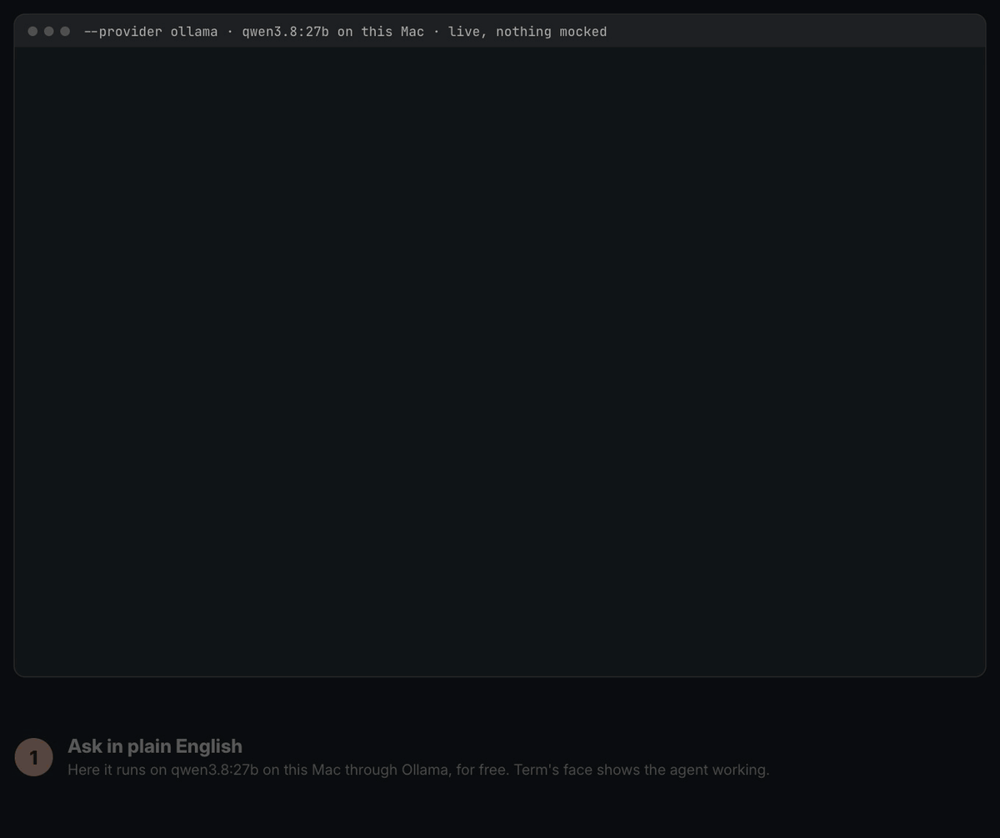
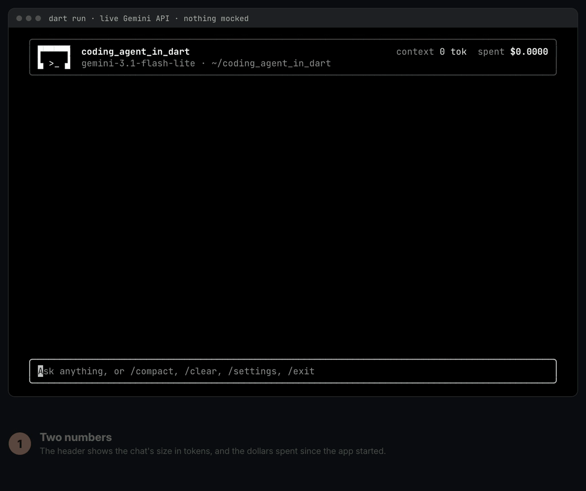
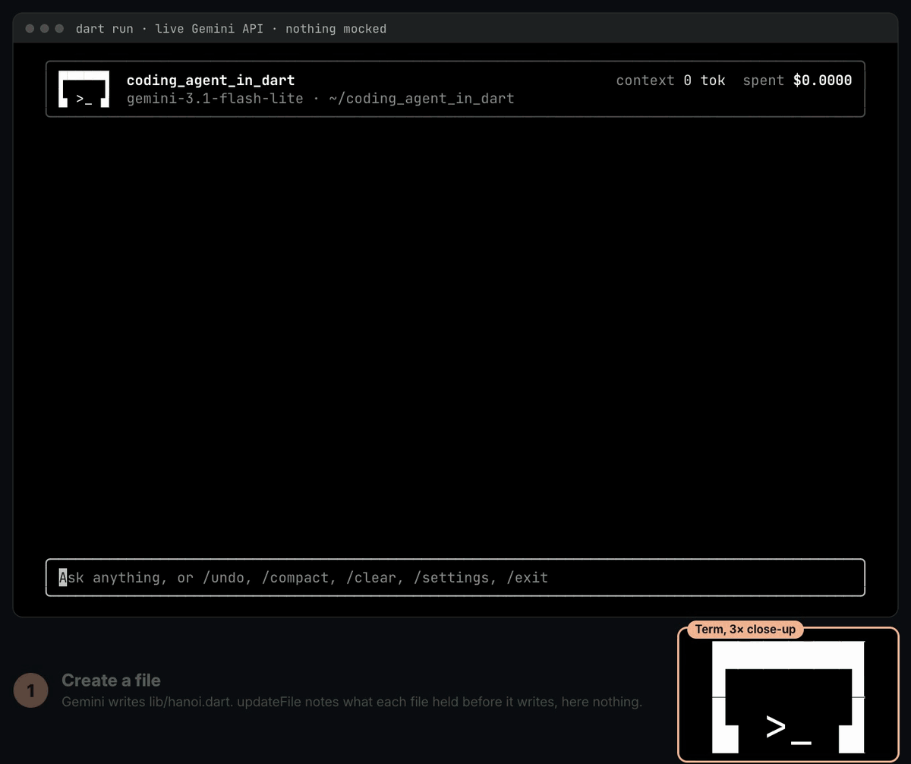
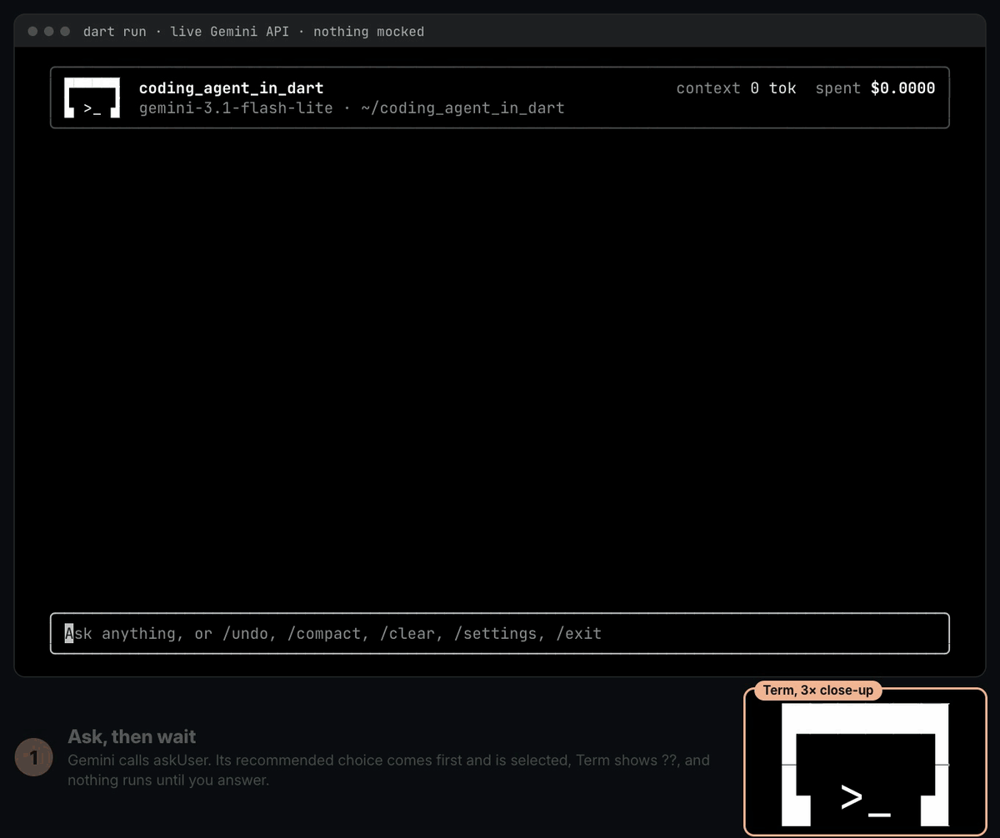
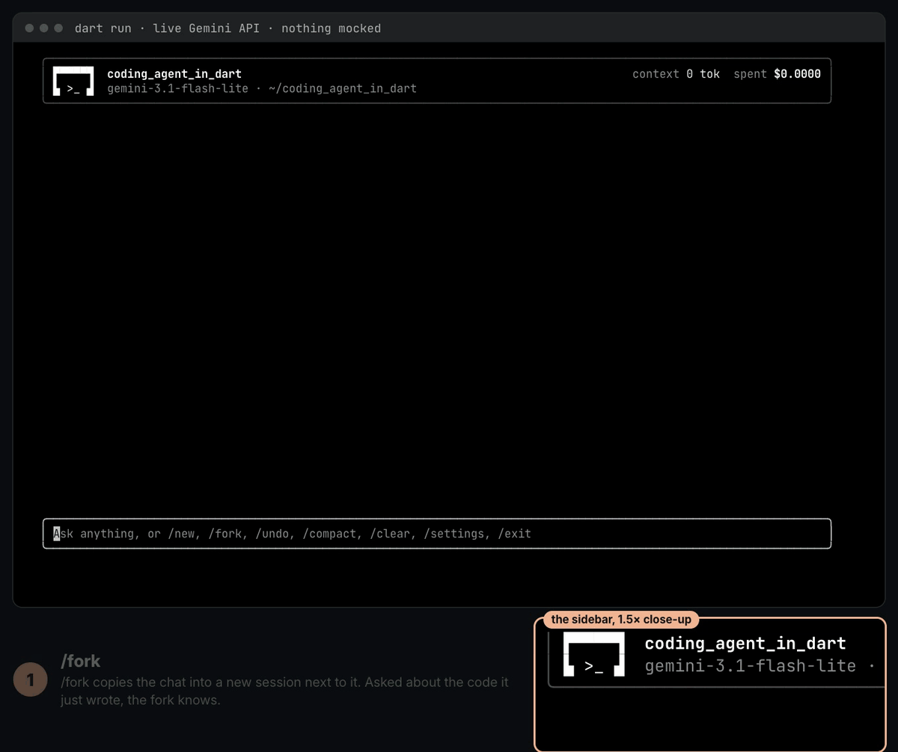
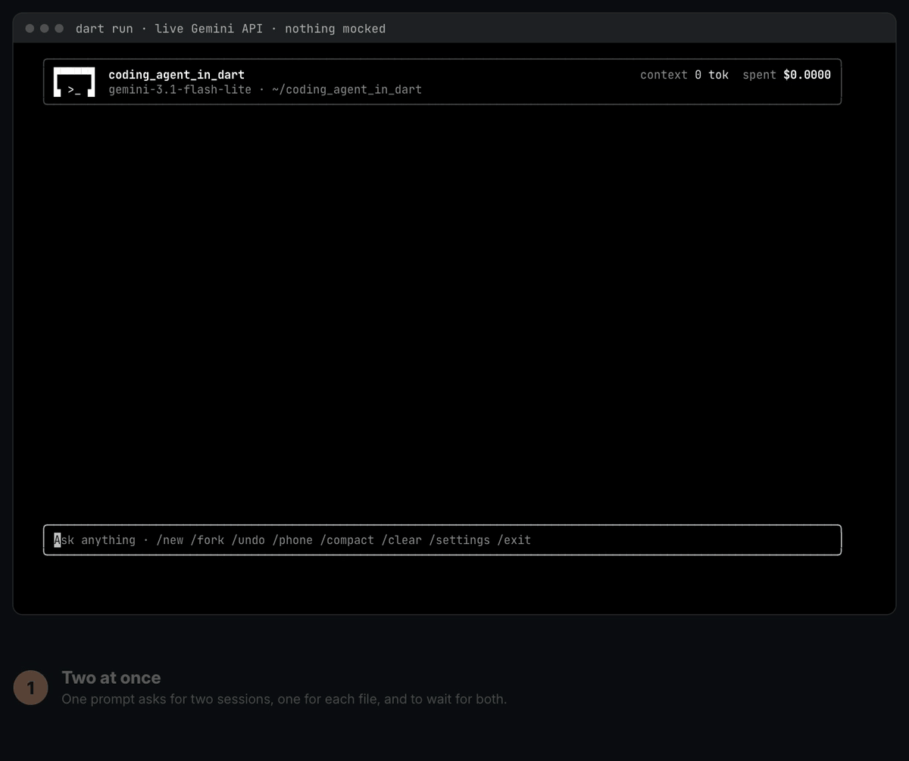
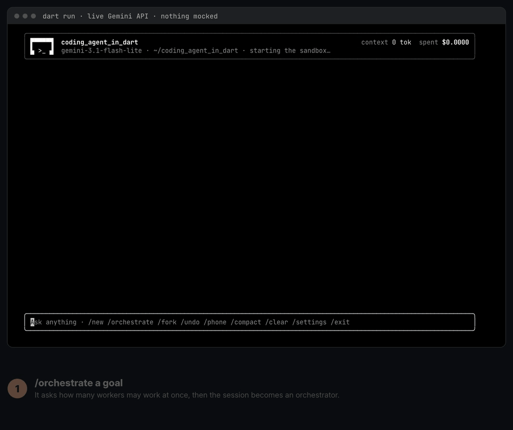
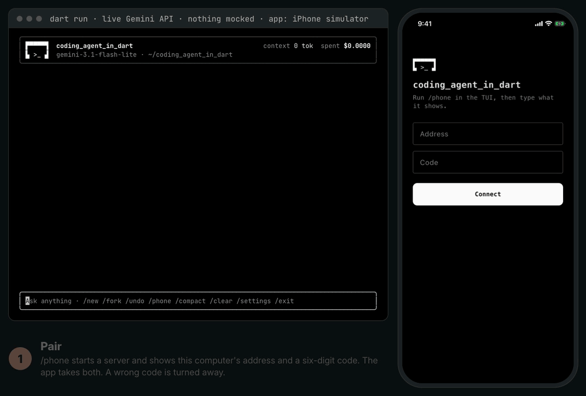
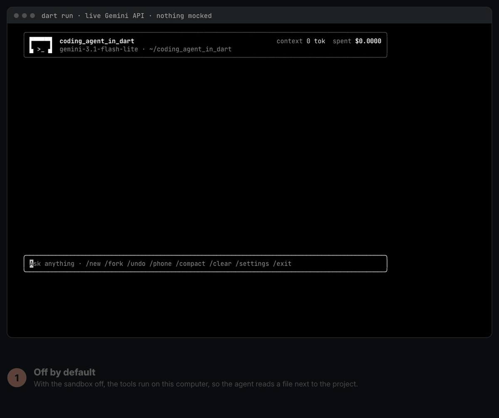
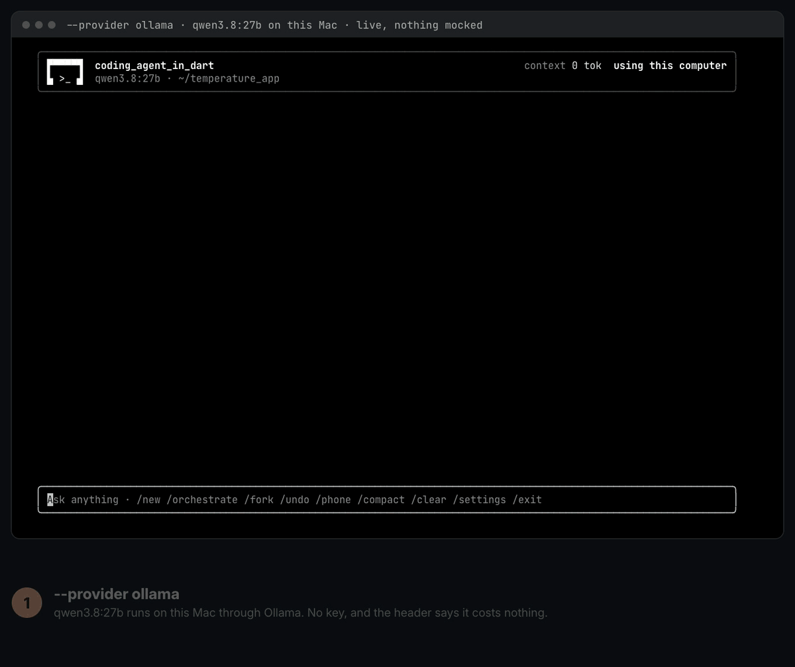

# agent_harness_in_dart

A coding agent written in Dart. It has a terminal UI built with [nocterm](https://pub.dev/packages/nocterm), which brings Flutter-style widgets to the terminal, and a Flutter app that drives it from your phone.



The harness is everything around the model: the agent loop, the tools that read and edit your files, the UI, sessions, cost tracking and the sandbox. The model is swappable. It runs on Gemini, DeepSeek, Kimi, Groq or OpenRouter with an API key, or for free on a local model through Ollama.

## What it does

- **Real diffs.** Every file edit shows the diff of what actually changed on disk, worked out from the file, not typed by the model.
- **Term, the mascot.** Term's face shows what the agent is doing: `>_` waiting, moving eyes while it works, `^^` done, `××` an error, `<<` after an undo, `??` when it needs you. `/settings` switches between three themes.
- **Cost in the header.** Tokens and dollars spent so far, per session. The prices live in `settings.json`, so you can edit them.
- **`/undo`.** Puts back the file the agent's last edit changed, and tells the model it did.
- **The model can ask you.** With the `askUser` tool it stops and gives you options, with its recommended answer first.
- **Sessions.** A sidebar of chats. `/new` and `/fork` start one, and you can drag sessions out of the sidebar to see several side by side in a grid. Ctrl+Tab and Ctrl+Shift+Tab move between them.
- **Agents that talk to each other.** A session can message another one, wait for its reply, and list what the others are doing.
- **Orchestrator mode.** `/orchestrate <goal>` writes a todo list and starts a worker session for each todo. The orchestrator itself can only run read-only checks, so every change sits in a worker's session, where `/undo` can take it back.
- **A phone app.** `/phone` lets the Flutter app connect over Wi-Fi or Tailscale. It streams every session live, diffs included, sends prompts, and answers the model's questions.
- **A sandbox.** Turn it on in `/settings` and the agent's tools run in a Docker container with no network. The container sees only your project and Dart's package cache, which it can read but not change.

<details>
<summary>See each feature in action</summary>

**Term**


**Cost**



**/undo**



**askUser**



**Sessions**



**Agents**



**Orchestrator**



**Phone app**



**Sandbox**



**Ollama**



</details>

## Run it

You need Dart 3.10.4 or newer.

```bash
git clone https://github.com/Coffiie/agent_harness_in_dart.git
cd agent_harness_in_dart/tui
dart pub get
export GEMINI_API_KEY=your-key
dart run coding_agent_in_dart
```

With no options it uses Gemini (`gemini-3.1-flash-lite`). To use another provider, pass `--provider` and set its key:

| Provider | Option | Key |
|---|---|---|
| Gemini | none | `GEMINI_API_KEY` |
| Ollama, on your computer | `--provider ollama` | none, it's free |
| DeepSeek | `--provider deepseek` | `DEEPSEEK_API_KEY` |
| Kimi | `--provider kimi` | `MOONSHOT_API_KEY` |
| Groq | `--provider groq` | `GROQ_API_KEY` |
| OpenRouter | `--provider openrouter` | `OPENROUTER_API_KEY` |

`--model <name>` picks a model, and `--models` lists the ones you can use. For Ollama, start Ollama and pull a model that supports tool calls first. The Ollama demo uses a Qwen model.

There's also `--chatgpt`, which signs in with your ChatGPT plan (Plus or Pro) in the browser and uses it instead of an API key. It's experimental: the sign-in hasn't been tested end to end yet.

`dart run coding_agent_in_dart --help` shows every option.

## Commands

| Command | What it does |
|---|---|
| `/new` | Starts an empty session |
| `/new <prompt>` | Starts a session for that prompt, with a summary of this chat if the prompt needs it |
| `/fork` | Starts a session with a copy of this chat |
| `/undo` | Puts back the file the last edit changed |
| `/compact` | Replaces the chat with a summary, to free up context |
| `/clear` | Starts this chat over |
| `/orchestrate <goal>` | Turns this session into an orchestrator for the goal |
| `/todos` | Shows the orchestrator's todo list |
| `/stop` | Stops the orchestrator: no new todos start, and workers finish the step they're on |
| `/phone` | Shows the address and code for the phone app |
| `/settings` | Theme and sandbox |
| `/exit` | Quits |

Settings are saved in `~/.config/coding_agent_in_dart/settings.json`.

## The phone app

You need Flutter 3.38.5 (the version in `.fvmrc`).

1. In the TUI, type `/phone`. It shows your computer's address and a six-digit code.
2. Put your phone on the same Wi-Fi as the computer, or on the same Tailscale network.
3. Run the app with `flutter run` in `phone_app/`, with a phone or simulator connected.
4. Type the address and the code, and tap Connect.

The code changes every time the TUI starts the server, and five wrong codes shut it until you type `/phone` again.

## The sandbox

Install Docker, then turn the sandbox on in `/settings`. It uses the official Dart image for the Dart version you run, so the tests the agent runs work inside it. If that image isn't pulled yet, the harness tells you the exact `docker pull` command to run. While the sandbox is on but can't start, the tools refuse to run rather than fall back to your computer. With the sandbox off, which is the default, they run on your computer.

## Layout

```
core/       the agent without a UI: the loop, model providers, tools, sessions,
            orchestration, the sandbox, the phone link's server, and the design
            system (palettes and Term's faces)
tui/        the terminal UI, built with nocterm on core
phone_app/  the Flutter app that drives the TUI from a phone, on core's design system
docs/       the demo GIFs
```

`tui` and `phone_app` depend on `core` by path. `core` has no UI library in it, so both can use it, and each turns core's palette into its own colors. `cd core && dart run coding_agent_core:cli` runs the first plain CLI, without the TUI.

## Tests

```bash
cd core && dart test
cd tui && dart test
cd phone_app && flutter test
```

## How it was built

Claude Code wrote the code. I decided the architecture, tested every change and told it what was wrong. Each feature landed as its own [pull request](https://github.com/Coffiie/agent_harness_in_dart/pulls?q=is%3Apr+is%3Amerged), with a demo GIF and an architecture diagram.

The build is also a video series on YouTube:

- [Part 1](https://youtu.be/7OnyYHEyNcY)
- [Part 2](https://youtu.be/DC6xp9vD1cs)
